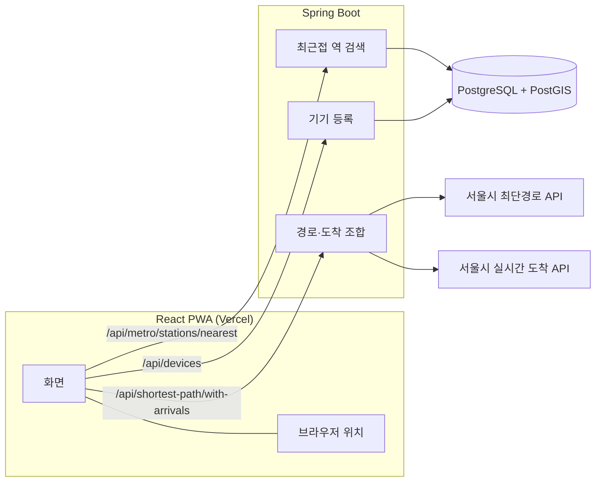
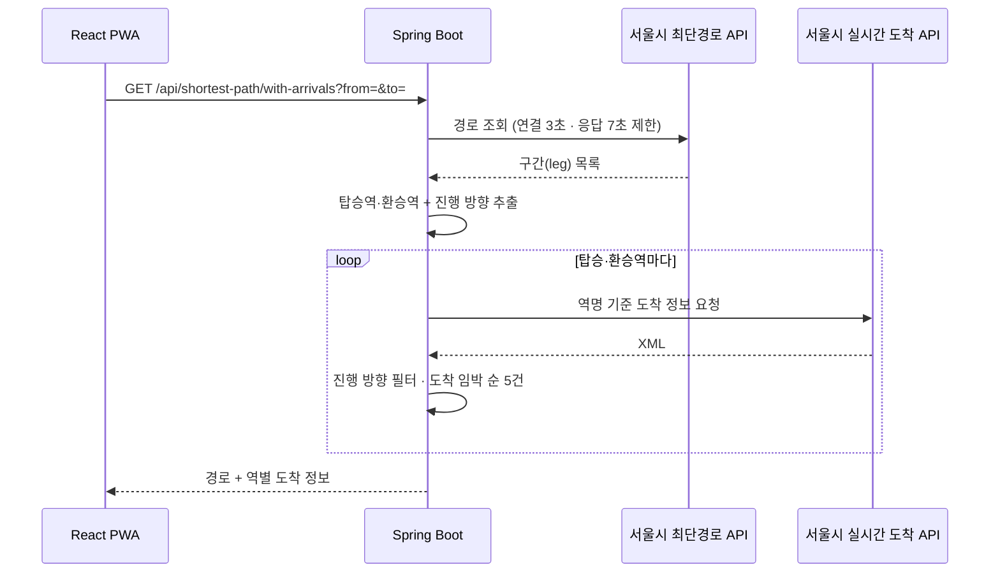

# 실시간 지하철 알리미 (live-bmw)

출발역·도착역을 넣으면 최단 경로의 탑승역·환승역마다 **내가 탈 방향 열차**의 실시간 도착 정보를 한 화면에 보여주는 모바일 웹앱(PWA).

- 운영 — 실서비스로 배포·운영 후 종료 (프론트엔드 Vercel · API `livebmw.cloud`)
- 개발 기간 — 2025.08.23 ~ 2025.09.09 · 개인 프로젝트 · 커밋 55개

---

## 한눈에 보기

| 항목 | 내용 |
|---|---|
| 기능 | 현재 위치 기준 가까운 역 3곳 · 최단 경로 + 탑승·환승역별 진행 방향 열차 도착 카운트다운 |
| 구조 | React PWA → Spring Boot API → 서울시 최단경로·실시간 도착 API 조합 + PostGIS 공간 질의 |
| 핵심 결정 | 외부 API 조합을 백엔드로 집중(BFF) — 화면 하나를 요청 1회로 구성 |
| 기준 데이터 | 지하철역 786곳 좌표 CSV → 기동 시 PostGIS Point(EPSG:4326)로 적재 |

---

## 아키텍처



### 경로 + 도착 정보 조회 흐름



---

## 설계 결정과 트레이드오프

### 1. 외부 API 조합을 백엔드에서 — BFF 구조

- 결정 — 경로 조회 → 환승역 추출 → 역별 도착 조회를 서버에서 한 번에 처리
- 근거 — 프론트는 요청 1회로 화면 구성 · 외부 API 키와 XML 파싱을 서버로 일원화
- 대가 — 외부 API 지연을 서버가 그대로 떠안음 → 최단경로 API 호출에 타임아웃(연결 3초 · 응답 7초)으로 상한 설정

### 2. 최근접 역 검색 — DB 공간 질의

- 결정 — PostGIS KNN 정렬(`ORDER BY geom <-> point`) + `ST_DistanceSphere`로 미터 단위 거리 계산
- 근거 — 거리 계산·정렬을 DB에서 끝내고 상위 N개만 전송
- 규모 판단 — 역 786곳 규모는 공간 인덱스 없이도 충분 → 버스 정류장 등으로 확장 시 GiST 인덱스 필요

### 3. 환승역·진행 방향 추출 — 도메인 로직

- 결정 — 경로 구간(leg)에서 노선이 바뀌는 지점을 환승으로 판정, 환승 후 진행 방향을 함께 산출
- 결과 — 역의 전체 열차가 아닌 "내가 탈 방향" 열차만 표시

### 4. 로그인 없는 기기 식별

- 결정 — 브라우저에서 UUID 생성·로컬 저장 → 서버에 등록 후 접속(check-in) 시 최초·최근 접속 시각 기록
- 근거 — 회원가입 없이 바로 사용 · 재방문 기기 구분
- 대가 — 브라우저 저장소 초기화 시 새 기기로 인식 · 기기 간 이어보기 불가

### 5. 기준 데이터 적재 — 기동 시 1회

- 결정 — 애플리케이션 기동 시 역 좌표 CSV를 JTS Point로 변환해 적재, 데이터가 있으면 건너뜀
- 근거 — 재기동해도 중복 적재 없음 · 별도 마이그레이션 도구 불필요

### 6. 도메인별 패키지 · 계층 분리

- 구조 — `metro` · `shortestpath` · `device` 도메인마다 `api` → `application` → `domain` 계층
- 외부 연동 — 최단경로 API 호출을 `application/adapter`로 분리 → 외부 API 교체 시 영향 범위 한정 (실시간 도착 API는 서비스 내 직접 호출)

---

## 한계와 개선 방향

- 환승역별 도착 조회가 순차 실행 — 환승이 많을수록 지연 누적 → WebClient 비동기 병렬 호출로 개선 가능
- 외부 API 응답 캐시 없음 — 같은 역 반복 조회 시 호출 증가 → 도착 정보 갱신 주기에 맞춘 짧은 캐시 검토
- 저장소 기본 설정이 H2 인메모리 — PostGIS 함수(`ST_DistanceSphere`) 실행 불가 → 운영 DB용 설정 프로필 분리 필요
- 테스트가 기기 등록 영역에만 존재 — 환승역 추출 로직이 우선 보강 대상

---

## 기술 스택

| 영역 | 사용 기술 |
|---|---|
| Backend | Java 17 · Spring Boot 3.5 · Spring Data JPA · Hibernate Spatial · JTS · WebClient · Jackson XML |
| DB | PostgreSQL + PostGIS |
| Frontend | React 19 · Vite · PWA (홈 화면 설치) |
| 배포 (종료) | Vercel (프론트엔드) · `livebmw.cloud` (API) |
| 외부 데이터 | 서울시 지하철 최단경로 API · 실시간 도착정보 API · 지하철역 좌표 CSV |

---

## API

| Method | Path | 설명 |
|---|---|---|
| GET | `/api/metro/stations/nearest?lat=&lng=&limit=3` | 좌표 기준 가까운 역 |
| GET | `/api/shortest-path?from=&to=` | 최단 경로 |
| GET | `/api/shortest-path/with-arrivals?from=&to=` | 최단 경로 + 탑승·환승역별 도착 정보 |
| POST | `/api/devices` | 기기 등록 |
| GET | `/api/devices/{deviceId}` | 기기 조회 |
| POST | `/api/devices/{deviceId}/check-in` | 접속 기록 |
| DELETE | `/api/devices/{deviceId}` | 기기 삭제 |

---

## 실행에 필요한 설정

| 키 | 용도 |
|---|---|
| `seoul.shortest.path.api.key` | 서울시 최단경로 API 키 |
| `seoul.live.metro.arrival.api.key` | 서울시 실시간 도착정보 API 키 |
| `livebmw.metro.station-import.csv` | 역 좌표 CSV 위치 |
| `app.cors.allowed-origins` | 프론트엔드 도메인 |
| `spring.datasource.*` | PostgreSQL + PostGIS 접속 정보 |

```bash
# backend
cd live-bmw/backend && ./gradlew bootRun

# frontend (VITE_API_BASE = 백엔드 주소)
cd live-bmw/frontend && npm install && npm run dev
```

---

## 프로젝트 구조

```
live-bmw/
├── backend/src/main/java/com/livebmw/
│   ├── metro/          # 역·노선, 최근접 역 검색, 실시간 도착
│   ├── shortestpath/   # 최단 경로 + 환승역 도착 정보 조합
│   │   └── application/adapter/seoul/   # 서울시 API 연동
│   ├── device/         # 로그인 없는 기기 등록
│   └── common/         # 오류 응답, 시간 변환, 좌표계 유틸
└── frontend/src/
    ├── components/     # 도착 카드, 노선 배지, 역 입력
    ├── hooks/          # 위치, 카운트다운, 기기 등록, 역 검색
    └── api/            # 백엔드 호출
```
